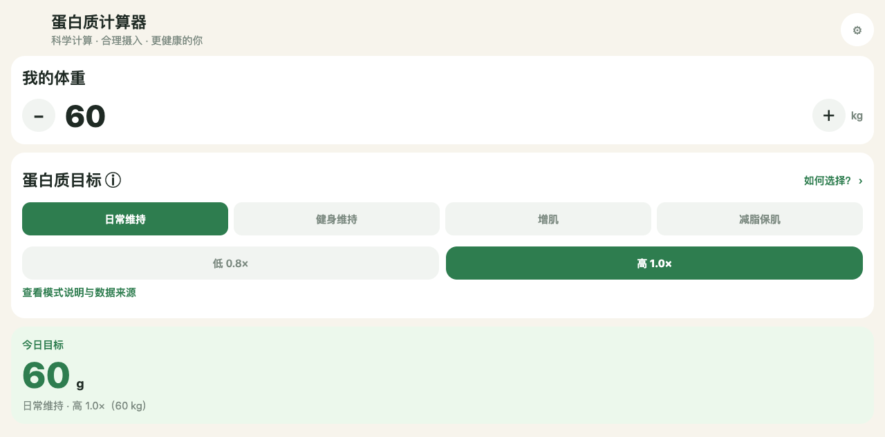

# Protein Calculator (Web)

Works out how much protein you need today from your weight and goal, then records chicken, eggs, tofu and other everyday foods so you can see how much is still missing.

English | [中文](README.md)



## What it is

The standalone web version of Protein Calculator, reusing the Android app's screens, food data and calculation logic. Open the page, enter your weight, pick a goal mode and level, and the daily target appears; add foods to see the running total and the remaining amount.

No account, no backend: everything you enter stays in the current browser.

## Features

- **Weight and goal**: four goal modes (daily maintenance / fitness maintenance / muscle gain / fat loss with muscle retention), each with a low and a high coefficient; "How to choose?" explains the modes and data source.
- **Daily target and progress**: target grams, protein already eaten, and how much is left.
- **Food log**: built-in foods with protein per 100 g and common serving sizes; enter by serving or by grams. You can add custom foods and edit built-in ones — changes affect this device only.
- **Top 30 high-protein ranking**: sorted by protein per 100 g edible portion, sourced from the China CDC food composition query platform.
- **Daily diet record**: enter a whole day's foods at once and jump straight to changing the goal.
- **Look and language**: light / dark / follow system; Simplified Chinese / English / follow system.

## Quick Start

Requires Node.js 24 and npm:

```sh
npm ci
npm run typecheck
npm run build
python3 -m http.server 8765 --directory dist
```

Open `http://127.0.0.1:8765/` in a desktop browser. Check that the port is free first, and stop the temporary server when done.

`dist/` is the complete static publish directory; assets use relative paths so it works under a GitHub Pages project subpath. Do not open it via `file://` — browser storage and offline caching require HTTP(S).

## Publishing

`.github/workflows/pages.yml` builds and deploys to GitHub Pages; select GitHub Actions as the Pages source. Live site: <https://wanghoufan.github.io/p062-protein-calculator-pwa/>.

`scripts/prepare-web.cjs` generates `manifest.webmanifest`, `service-worker.js` and `.nojekyll`, switches `index.html` to `zh-CN` and injects the service-worker registration. GitHub Pages does not serve dotfiles (`.nojekyll` returned 404 in testing), so the service-worker precache list must exclude dotfiles; otherwise `cache.addAll` fails and offline support breaks entirely (hit on 2026-10-27, fixed and re-verified).

## Offline and data

After the first online load and cache completion, the app can be reopened offline in the same browser; updates also need a network connection. Clearing site data, switching devices or having browser storage cleaned by the system can lose your data. There is no cloud sync, so the offline cache is not a backup.

## Layout

- `App.tsx`, `src/` — screens, components, domain calculations, local storage, theme and i18n
- `assets/` — icons and food illustrations
- `scripts/prepare-web.cjs` — web output finishing (manifest / SW / `.nojekyll`)
- `docs/` — architecture facts, handoff and retrospectives
- `.github/workflows/pages.yml` — Pages build and deploy

## Boundaries

- Values are nutrition estimates; the actual food package label wins.
- iPhone compatibility (Safari add-to-home-screen, offline reopen) is unverified. Service-worker activation, offline reopen and basic calculation were verified on Android Note 11T Pro+ and Note 11 5G.
- Original Android project: [Protein Calculator](https://github.com/wanghoufan/p027-protein-calculator).
