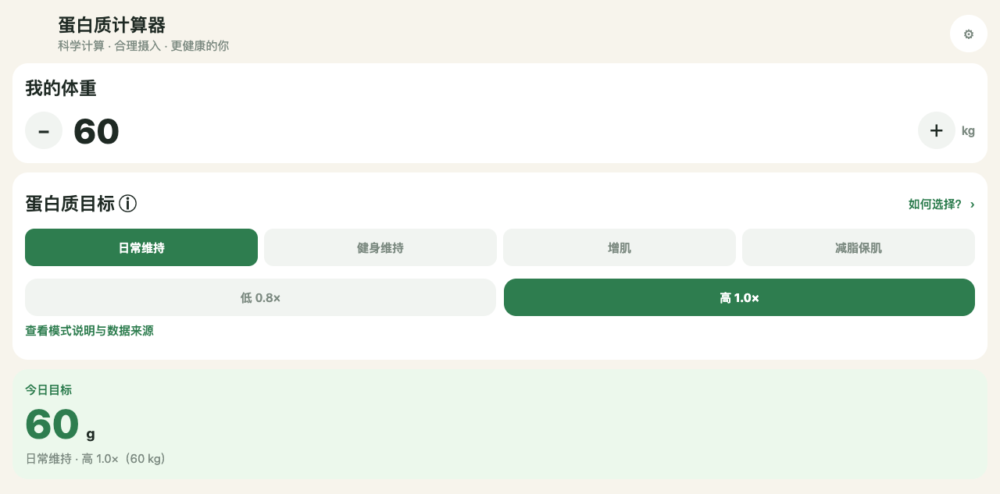

# 蛋白质计算器（网页版）

按体重和目标算出今天该吃多少蛋白质，再把鸡肉、鸡蛋、豆制品等常见食物的摄入量记下来，随时看到还差多少。

中文 ｜ [English](README.en.md)



## 这是什么

「蛋白质计算器」的独立网页版，界面、食物数据和计算逻辑沿用安卓工程。打开网页即可用：先填体重，再选目标模式和档位，页面会算出今日目标；在食物列表里录摄入量，自动累计并显示还差多少。

没有账号、没有后端，所有输入都保存在当前浏览器里。

## 能做什么

- **体重与目标**：四种目标模式（日常维持 / 健身维持 / 增肌 / 减脂保肌），每种模式分低、高两档系数；「如何选择？」里给出说明与数据来源。
- **今日目标与进度**：显示目标克数、已摄入量和还差多少。
- **食物记录**：内置常见食物（按每 100 克蛋白质含量与常用份量），可改份量或按克数输入；支持添加自定义食物、修改内置食物，改动只影响本机。
- **高蛋白榜 Top 30**：按每 100 克可食部蛋白质含量排序，数据来自中国疾控《中国食物成分表》查询平台。
- **一日饮食记录**：把当天吃过的食物一次性录入，并可直接跳到修改目标。
- **外观与语言**：浅色 / 深色 / 跟随系统；简体中文 / English / 跟随系统。

## 快速开始

需要 Node.js 24 和 npm：

```sh
npm ci
npm run typecheck
npm run build
python3 -m http.server 8765 --directory dist
```

在桌面浏览器打开 `http://127.0.0.1:8765/`。先确认端口未被其他服务占用；任务结束后停止临时服务。

`dist/` 是完整的静态发布目录，资源使用相对路径，支持 GitHub Pages 项目子目录。不要直接用 `file://` 打开——浏览器存储和离线缓存需要 HTTP(S)。

## 发布

`.github/workflows/pages.yml` 负责构建并发布 GitHub Pages，仓库 Pages 设置选 GitHub Actions。线上地址：<https://wanghoufan.github.io/p062-protein-calculator-pwa/>。

`scripts/prepare-web.cjs` 会生成 `manifest.webmanifest`、`service-worker.js` 和 `.nojekyll`，并把 `index.html` 改为 `zh-CN`、注入 SW 注册。GitHub Pages 不提供点文件（`.nojekyll` 实测 404），所以 Service Worker 的预缓存清单必须剔除点文件，否则 `cache.addAll` 失败、离线能力整体失效（2026-10-27 踩中，已修复并复验）。

## 离线与数据

首次联网打开并缓存完成后，可在同一浏览器离线重开；更新应用也需要联网。清除浏览器网站数据、换设备或浏览器存储被系统清理都可能造成数据丢失；没有云端同步，不能把离线缓存当备份。

## 目录

- `App.tsx`、`src/` — 页面、组件、领域计算、本地存储、主题与 i18n
- `assets/` — 图标与食物配图
- `scripts/prepare-web.cjs` — 网页产物收尾（manifest / SW / `.nojekyll`）
- `docs/` — 架构事实、交接与复盘
- `.github/workflows/pages.yml` — Pages 构建与发布

## 边界

- 内容为营养估算，具体以实际食品包装标示为准。
- iPhone 实机兼容性（Safari 添加到主屏幕、断网重开）尚未验证；已在安卓 Note 11T Pro+ 与 Note 11 5G 上验证 SW 激活、断网重开与基础计算。
- 安卓原项目：[蛋白质计算器](https://github.com/wanghoufan/p027-protein-calculator)。
